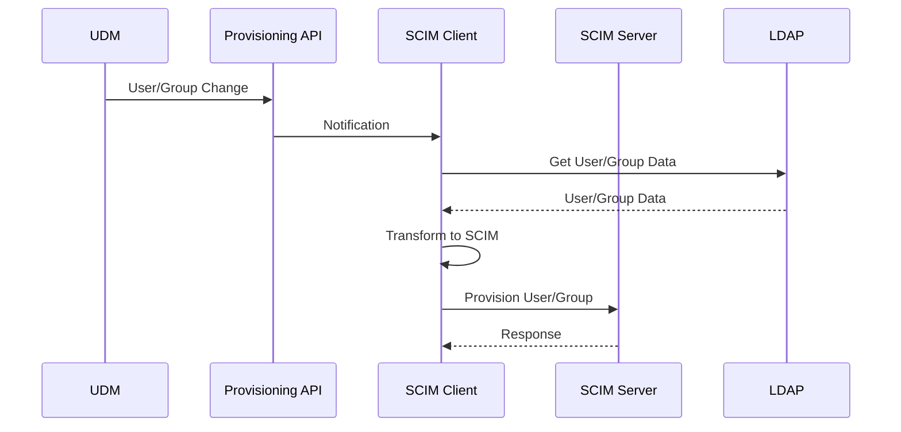

# SCIM Client

## Purpose

The SCIM client is a component that connects to a SCIM-compliant service provider to provision users and groups. It acts as a bridge between the Nubus environment and other systems that support the SCIM standard.

## Status

**Experimental:** This component is currently experimental and intended for preliminary testing only. It is not yet recommended for production use.

## Limitations

- **Lack of Configurability:** The SCIM client currently has limited configuration options.
- **External ID:** The target SCIM server must be configured to handle the `externalId` attribute for mapping users and groups.

## Known Issues

There are no known issues at this time.

## How to Execute

To run the SCIM client, deploy it using the provided Helm chart. The [SCIM Client chapter in the Nubus Operation Manual](https://docs.software-univention.de/nubus-kubernetes-operation/latest/en/connect-external-iam/scim-client.html) describes how to configure and install the chart.

For Kubernetes deployments, provide a separate PostgreSQL database for each SCIM Client and set `scimClient.config.dbConnectionString` in the Helm values.

## Error handling

The client stores provisioning tasks in a database and automatically retries network errors. Other failed tasks are kept in the Morgue for inspection, while processing continues.

Run `univention-scim-connector-task-management --help` inside the client container to see the available commands for inspecting and managing tasks.

## Configuration internals

Here are some details about the SCIM client's configuration for developers.

The scim-client needs credentials to the provisioning API that have an active subscription to the relevant topics. This needs to be done in an external setup by an admin user. For the tests, there are helper functions in `scim_helper.py` that can do this.

The client is configured via environment variables that are read in pydantic settings models.

### General configuration

- `SCIM_SERVER_BASE_URL`: URL of the SCIM server to connect to.
- `SCIM_AUTH_METHOD`: Authentication method with the SCIM server. One of "none", "oidc", "basic", "bearer". Depending on this, additional configuration becomes necessary.
- `PROVISIONING_DB`: A connection string to a database that is used to store active and failed tasks.
- `PROVISIONING_API_BASE_URL`: Base URL for the provisioning API (source data).
- `PROVISIONING_API_USERNAME`
- `PROVISIONING_API_PASSWORD`
- `MAX_ACKNOWLEDGEMENT_RETRIES`: Maximum retries to acknowledge a message in the provisioning API. Default 10.
- `HEALTH_CHECK_ENABLED`: Whether to do a connection check before each request. true|false, default false.
- `GROUP_SYNC_ENABLED`: Whether groups should be synchronized to the server. Experimental. true|false, default false.
- `SCIM_USER_FILTER_ATTRIBUTE`: UDM attribute that must exist on a user and be truthy for the user to be synced. Optional, by default all users are synced.
- `SCIM_GROUP_FILTER_ATTRIBUTE`: Similar to `SCIM_USER_FILTER_ATTRIBUTE`, but for group sync.
- `EXTERNAL_ID_USER_MAPPING`: The UDM attribute of a user that gets mapped to `externalId` in the SCIM target. Default unset (no `externalId` is written). Setting this to "univentionObjectIdentifier" often makes sense.
- `EXTERNAL_ID_GROUP_MAPPING`: Similar to `EXTERNAL_ID_USER_MAPPING` for group sync.
- `USERNAME_MAPPING`: The UDM attribute of a user that gets mapped to the user name in the SCIM target. Default "username".
- `LOG_LEVEL`: One of "TRACE", "DEBUG", "INFO", "WARNING", "ERROR", "CRITICAL". Default "INFO".

### Configuration for OIDC authentication

- `SCIM_OIDC_TOKEN_URL`
- `SCIM_CLIENT_ID`
- `SCIM_CLIENT_SECRET`
- `SCIM_SCOPES`: List of strings like '["scope1","scope2"]'.

### Configuration for HTTP basic authentication

- `SCIM_BASIC_AUTH_USERNAME`
- `SCIM_BASIC_AUTH_PASSWORD`

### Configuration for bearer token authentication

- `SCIM_BEARER_TOKEN`

### LDAP configuration

A connection to the source LDAP is required when group sync is enabled.

- `LDAP_HOST`
- `LDAP_BIND_DN`
- `LDAP_BIND_PASSWORD`

### Test configuration

Some environment variables govern how tests are run. They are prefixed with `TESTCONF_`.

- `TESTCONF_UDM_BASE_URL`: Base URL for the UDM in which tests create users and groups.
- `TESTCONF_UDM_USERNAME`
- `TESTCONF_UDM_PASSWORD`
- `TESTCONF_PROVISIONING_API_ADMIN_USERNAME`: Admin username for the provisioning API, used to create/delete subscriptions.
- `TESTCONF_PROVISIONING_API_ADMIN_PASSWORD`
- `TESTCONF_UNIVENTION_SCIM_SERVER`: Whether the target system is the Univention SCIM server.
- `TESTCONF_DOWNSTREAM_UDM_BASE_URL`: When the target system is the Univention SCIM server, base URL of the target UDM (tests need to access it for setup).
- `TESTCONF_DOWNSTREAM_UDM_USERNAME`
- `TESTCONF_DOWNSTREAM_UDM_PASSWORD`
- `TESTCONF_RUN_WIRE_COM_INTEGRATION_TESTS`: Whether to run integration tests against the real deployment of wire.com's SCIM server.
- `TESTCONF_WIRE_COM_SCIM_BEARER_TOKEN`: Bearer token for wire.com integration tests.
- `TESTCONF_KEYCLOAK_BASE_URL`
- `TESTCONF_KEYCLOAK_ADMIN_PASSWORD`

## How to Execute Tests

There are different kinds of tests. The easiest are unit tests that don't depend on any external service. Locally, these can be run separately by selecting the `unittest` mark: `uv run pytest -m unittest`. They are also run as part of the dockerized tests.

Then there are integration tests against either a reference SCIM server (the Python `scim2-server` implementation), or the Univention SCIM server (`scim-server` in this repository). They let the app interact with the server and then check that the correct results show up on the server. In general, they start the consumer in a background process, modify something in LDAP (e.g. create a new user), let those changes propagate to the provisioning API and to the app, and wait for the app to process the change correctly with the SCIM serve (e.g. creating the new user). Integration tests try to clean up after themselves, which may not always work if a test fails.

Integration tests require the SCIM server and a few other dependencies to be available. The dependencies can be started from the `tests/docker-compose.yaml`, which has 4 profiles:

- `dependencies-univention-server`: just the dependencies to run against the Univention server
- `dependencies-reference-server`: just the dependencies to run against the reference server
- `test-univention-server`: dependencies plus the test service itself
- `test-reference-server`: dependencies plus the test service itself

Use the `dependencies-*` profiles to `up` the services so you can run pytest locally.

### Integration tests against the reference server

To run tests against the reference server:

```bash
docker compose --profile dependencies-reference-server up --build  # optionally -d
# Now the dependencies are running and pytest can run integration tests.
uv run pytest
# The dependencies are still running and can be used for further tests. Shut them down with
docker compose --profile dependencies-reference-server down --volumes
```

For local pytest runs, the `pyproject.toml` sets default values for environment variables that mean it _should_ all just work. Otherwise see also the environment of the `test-against-reference-server`/`test-against-univention-server` services in the test compose file.

Alternatively, run the tests completely dockerized with a single command:

```bash
docker compose --profile test-reference-server run --rm --build test-against-reference-server
```

This will also leave the dependencies running for further tests (local or dockerized).

### Integration tests against the reference server

Integration tests against the Univention SCIM server work almost the same, except: the profile is called `dependencies-univention-server`, and the environment variable `TESTCONF_UNIVENTION_SCIM_SERVER=true` must be set:

```bash
docker compose --profile dependencies-univention-server up --build  # optionally -d
TESTCONF_UNIVENTION_SCIM_SERVER=true uv run pytest
docker compose --profile dependencies-univention-server down --volumes
```

Or fully dockerized (`TESTCONF_UNIVENTION_SCIM_SERVER=true` is set by the service):

```bash
docker compose --profile test-univention-server run --rm --build test-against-univention-server
```

Note that the `*-reference-server` and `*-univention-server` profiles can't be `up`ped at the same time since both SCIM servers bind to the same port on localhost.

### Integration tests against the real wire.com SCIM server

There are also integration tests that run against the real deployment of wire.com's SCIM server. These are disabled by default via `TESTCONF_RUN_WIRE_COM_INTEGRATION_TESTS=false` because they need a real bearer token for authentication (created on the wire.com web UI). They create/modify/delete a bunch of users, which equates to inviting users to a wire.com team on the account of the user who owns the bearer token.

To run these tests locally, start the same dependencies as for the regular integration tests (`docker compose --profile dependencies-reference-server up --build`), then

```bash
TESTCONF_RUN_WIRE_COM_INTEGRATION_TESTS=true TESTCONF_WIRE_COM_SCIM_BEARER_TOKEN=<your_token> uv run pytest -m wire_com_integration_tests
```

With the mark `wire_com_integration_tests` you run only the wire.com tests, but of course leaving it out will run the other tests just fine. During the wire.com tests the SCIM server in the dependencies will not be used (since we're using wire.com). The tests will overwrite the `SCIM_SERVER_BASE_URL` automatically to point to wire.com.

You can also run the wire.com tests dockerized with the `test-against-wire-com` service (`TESTCONF_RUN_WIRE_COM_INTEGRATION_TESTS` gets set automatically by the compose file):

```bash
TESTCONF_WIRE_COM_SCIM_BEARER_TOKEN=<your_token> docker compose --profile test-reference-server run --rm --build test-against-wire-com
```

## Interfaces

The SCIM client interacts with the following systems:

- **SCIM Service Provider:** The target server to which users and groups are provisioned.
- **Nubus Provisioning API:** Used to subscribe to user and group changes in the Nubus environment.
- **LDAP:** Used to retrieve user and group information.

## Dependencies

The SCIM client depends on the following services:

- A running Nubus for Kubernetes instance.
- A SCIM-compliant service provider.
- Nubus Provisioning API.
- LDAP server.

## Architecture

The SCIM client is a listener module that subscribes to object changes in the Univention Directory Manager (UDM). When a user or group is created, updated, or deleted in UDM, the Provisioning API sends a notification to the SCIM client. The SCIM client then transforms the UDM data into the SCIM format and sends it to the target SCIM service provider.


