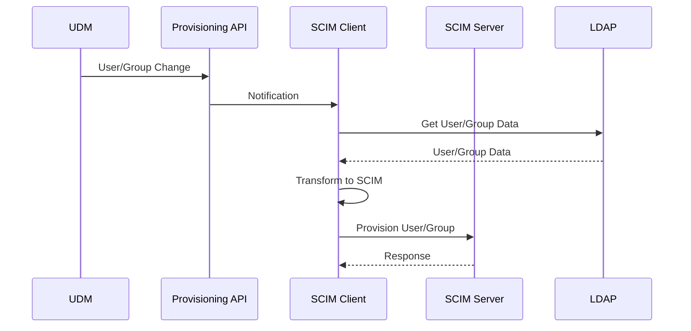

# SCIM Client

## Purpose

The SCIM client is a component that connects to a SCIM-compliant service provider to provision users and groups. It acts as a bridge between the Nubus environment and other systems that support the SCIM standard.

## Status

**Experimental:** This component is currently experimental and intended for preliminary testing only. It is not yet recommended for production use.

## Limitations

- **Lack of Configurability:** The SCIM client currently has limited configuration options.
- **External ID:** The target SCIM server must be configured to handle the `externalId` attribute for mapping users and groups.

## Known Issues

There are no known issues at this time.

## How to Execute

To run the SCIM client, deploy it using the provided Helm chart. See the [SCIM Client chapter in the Nubus Operation Manual](https://docs.software-univention.de/nubus-kubernetes-operation/latest/en/connect-external-iam/scim-client.html) for installation and configuration.

For Kubernetes deployments, provide a separate PostgreSQL database for each SCIM Client and set `scimClient.config.dbConnectionString` in the Helm values. The chart passes it to the client as `PROVISIONING_DB`.

## Error handling

The client stores provisioning tasks in a database and automatically retries network errors. Other failed tasks are kept in the Morgue for inspection, while processing continues.

Run `univention-scim-connector-task-management --help` inside the client container to see the available commands for inspecting and managing tasks.

## How to Execute Tests

There are different kinds of tests. The easiest are unit tests that don't depend on any external service. Locally, these can be run separately by selecting the `unittest` mark: `uv run pytest -m unittest`. They are also run as part of the dockerized tests.

Then there are integration tests against either a reference SCIM server (the Python `scim2-server` implementation), or the Univention SCIM server (`scim-server` in this repository). They let the app interact with the server and then check that the correct results show up on the server. In general, they start the consumer in a background process, modify something in LDAP (e.g. create a new user), let those changes propagate to the provisioning API and to the app, and wait for the app to process the change correctly with the SCIM serve (e.g. creating the new user). Integration tests try to clean up after themselves, which may not always work if a test fails.

Integration tests require the SCIM server and a few other dependencies to be available. The dependencies can be started from the `tests/docker-compose.yaml`, which has 4 profiles:

- `dependencies-univention-server`: just the dependencies to run against the Univention server
- `dependencies-reference-server`: just the dependencies to run against the reference server
- `test-univention-server`: dependencies plus the test service itself
- `test-reference-server`: dependencies plus the test service itself

Use the `dependencies-*` profiles to `up` the services so you can run pytest locally.

### Integration tests against the reference server

To run tests against the reference server:

```bash
docker compose --profile dependencies-reference-server up --build  # optionally -d
# Now the dependencies are running and pytest can run integration tests.
uv run pytest
# The dependencies are still running and can be used for further tests. Shut them down with
docker compose --profile dependencies-reference-server down --volumes
```

For local pytest runs, the `pyproject.toml` sets default values for environment variables that mean it _should_ all just work. Otherwise see also the environment of the `test-against-reference-server`/`test-against-univention-server` services in the test compose file.

Alternatively, run the tests completely dockerized with a single command:

```bash
docker compose --profile test-reference-server run --rm --build test-against-reference-server
```

This will also leave the dependencies running for further tests (local or dockerized).

### Integration tests against the reference server

Integration tests against the Univention SCIM server work almost the same, except: the profile is called `dependencies-univention-server`, and the environment variable `TESTCONF_UNIVENTION_SCIM_SERVER=true` must be set:

```bash
docker compose --profile dependencies-univention-server up --build  # optionally -d
TESTCONF_UNIVENTION_SCIM_SERVER=true uv run pytest
docker compose --profile dependencies-univention-server down --volumes
```

Or fully dockerized (`TESTCONF_UNIVENTION_SCIM_SERVER=true` is set by the service):

```bash
docker compose --profile test-univention-server run --rm --build test-against-univention-server
```

Note that the `*-reference-server` and `*-univention-server` profiles can't be `up`ped at the same time since both SCIM servers bind to the same port on localhost.

## How to rum scim-client against a dedicated scim-server

### wire.com

Create a `.env` file for the configuration

```bash
export SCIM_SERVER_BASE_URL="https://prod-nginz-https.wire.com/scim/v2"
export PROVISIONING_API_BASE_URL="http://localhost:7777/"
export PROVISIONING_API_USERNAME="scim-client"
export PROVISIONING_API_PASSWORD="univention"
export PROVISIONING_API_ADMIN_USERNAME="admin"
export PROVISIONING_API_ADMIN_PASSWORD="provisioning"
export LOG_LEVEL="DEBUG"
export MAX_ACKNOWLEDGEMENT_RETRIES="10"
export UDM_BASE_URL="http://localhost:9979/udm/"
export UDM_USERNAME="cn=admin"
export UDM_PASSWORD="univention"
export LDAP_HOST="localhost"
export LDAP_BIND_DN="cn=admin,dc=univention-organization,dc=intranet"
export LDAP_BIND_PASSWORD="univention"
export EXTERNAL_ID_USER_MAPPING="univentionObjectIdentifier"
export EXTERNAL_ID_GROUP_MAPPING="univentionObjectIdentifier"
export GROUP_SYNC_ENABLED="false"
export KEYCLOAK_BASE_URL="http://localhost:5050"
export SCIM_AUTH_METHOD="bearer"
export SCIM_BEARER_TOKEN="<wire.com scim token>"
```

Create the subscription

```bash
cd scim-client
docker compose -f tests/docker-compose.yaml --profile develop up --build --remove-orphans -d
(source .env && uv run /bin/bash)
python3 -c "import tests.data.scim_helper as scim_helper; scim_helper.create_provisioning_subscription()"
```

Run the scim client and do your tests

```bash
(source .env && uv run scim-client)
```

```bash
(source .env && uv run /bin/bash)
udm --uri "http://localhost:9979/udm/" --username "cn=admin" --bindpwd "univention" users/user create --set username="jbu12345" --set lastname="Burgmeier" --set password="Test1234" --set e-mail="jbu@scim-client.unittests"
```

Cleanup

```bash
docker compose -f tests/docker-compose.yaml --profile develop down --volumes
```

## Interfaces

The SCIM client interacts with the following systems:

- **SCIM Service Provider:** The target server to which users and groups are provisioned.
- **Nubus Provisioning API:** Used to subscribe to user and group changes in the Nubus environment.
- **LDAP:** Used to retrieve user and group information.

## Dependencies

The SCIM client depends on the following services:

- A running Nubus for Kubernetes instance.
- A SCIM-compliant service provider.
- Nubus Provisioning API.
- LDAP server.

## Architecture

The SCIM client is a listener module that subscribes to object changes in the Univention Directory Manager (UDM). When a user or group is created, updated, or deleted in UDM, the Provisioning API sends a notification to the SCIM client. The SCIM client then transforms the UDM data into the SCIM format and sends it to the target SCIM service provider.


